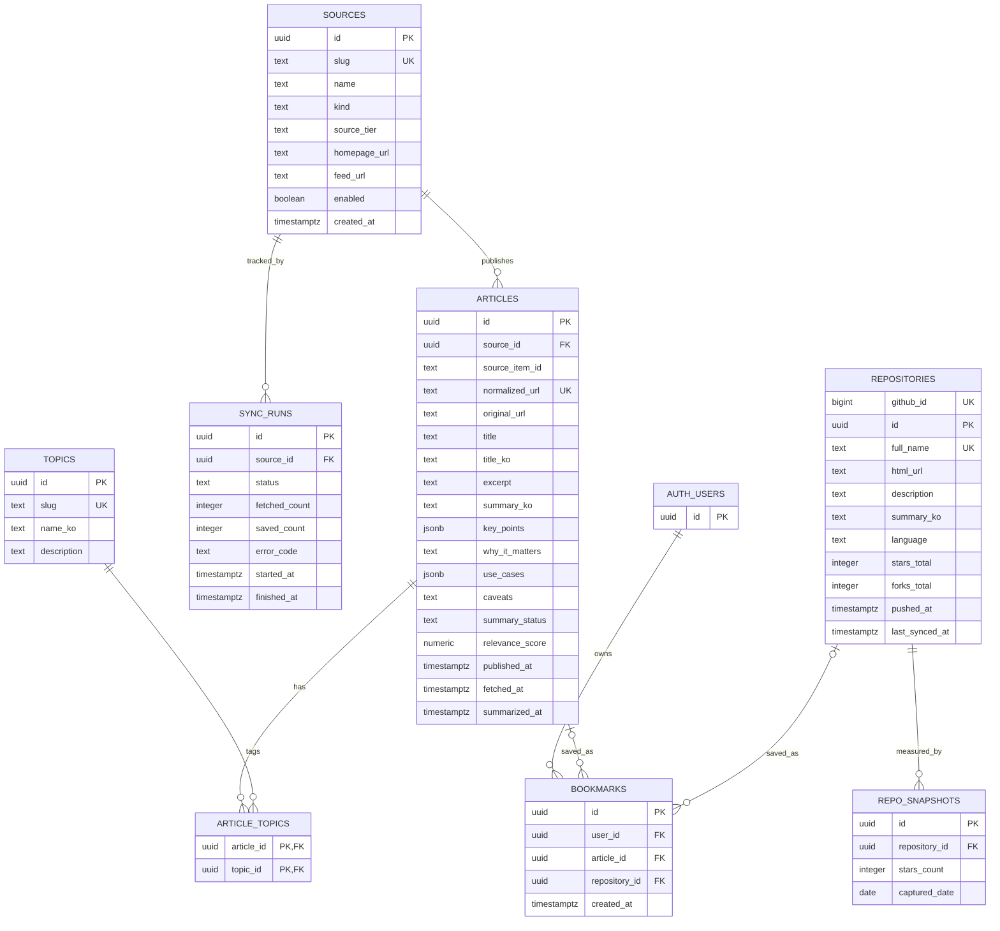

# IssueHub — 제품·UI·시스템 설계서

- 프로젝트: IssueHub (Discover · Understand · Learn)
- 개발 환경: Windows 11, PowerShell, Claude Code CLI, 바탕화면 `issuehub` 디렉터리
- 타깃: 한국어를 사용하는 주니어 개발자·개발 트렌드 탐색자
- 형태: AI 요약을 제공하는 IT 트렌드 큐레이션 웹 앱
- 원칙: 실데이터/데모 데이터 명확히 구분, 원문 링크 보존, 신뢰성≠인기도, 단계별 구현

## 1. 범위

### MVP (반드시 실제로 동작해야 함)
1. 반응형 다크/라이트 디자인 시스템, 글로벌 레이아웃 및 네비게이션
2. `/`, `/discover`, `/articles/[id]`, `/github`, `/topics/[slug]`, `/saved`, `/about`
3. 기사·저장소 목록/상세, 검색, 정렬, 필터, 페이징, 빈 상태, 오류/로딩 상태
4. GitHub Search API, Hacker News Firebase API 및 검증된 RSS 소스의 수집 어댑터
5. PostgreSQL/Supabase 스키마 + 마이그레이션 + 데모 데이터를 통한 로컬 즉시 실행
6. 동일 URL/외부 ID 기준 중복 제거 및 재실행해도 중복이 발생하지 않는 upsert
7. AI 요약 기능은 서버에서만 키 사용. 키가 없으면 요약을 꾸며내지 않고 미생성 상태를 표시
8. GitHub Actions에서 주기적 수집, 수동 실행 가능 (비밀키는 GitHub Secrets)
9. 익명 브라우저 북마크는 localStorage. 데이터 동기화/계정 로그인은 후속 단계
10. 기본 테스트, README, `.env.example`, `CLAUDE.md`, 실행·배포 가이드

### 2차 범위 (MVP 안정화 후)
- Supabase Auth, 계정 기반 북마크 동기화와 RLS
- Notion OAuth/연동 페이지 및 노트 내보내기
- 즐겨찾기 기술·키워드 설정, 개인화 추천
- 기술별 성장 추세 대시보드와 관측 기간별 저장소 증감
- 운영용 모니터링과 관리자 기능

### 명확히 제외
- 검증되지 않은 사이트에서의 무분별한 전문 크롤링
- LLM이 원문에 없는 기능/출처를 생성하는 요약
- 자체 GitHub Trending 결과를 GitHub 공식 Trending 순위라고 표기하는 행위
- 백그라운드 작업을 브라우저 요청만으로 장시간 수행하는 구조
- API 키·토큰을 브라우저 또는 Git 저장소에 노출하는 구현

## 2. 비주얼·UX 디자인

- 브랜딩: IssueHub, 심볼은 작은 radar/scan-mark; 텍스트 로고도 완성도 있게
- 스타일: Linear / Vercel / 고급 기술 저널의 정보 밀도에서 착안하되 특정 제품 복제 금지
- 기본 테마: 다크, 라이트 지원, 사용자 설정은 localStorage에 유지
- 다크 배경 `#0B1120`, surface `#111827`, elevated `#172234`, border `#263447`, text `#F8FAFC`, muted `#94A3B8`, accent `#38BDF8`
- 라이트 배경 `#F8FAFC`, surface `#FFFFFF`, border `#E2E8F0`, text `#0F172A`, muted `#64748B`, accent `#0284C7`
- CSS variables로 semantic tokens, WCAG AA 대비 목표. 색에만 의존하여 상태를 구분하지 않기.
- 레이아웃: desktop (>=1280) 좌측 사이드바 236px, 상단바 64px, 본문 max-width 1320px, 일부 페이지 우측 레일 280px; tablet 사이드바 축소; mobile 단일 열/상단 메뉴 + 하단 내비게이션.
- 본문 기본 15~16px, line-height 1.6+, 긴 제목 2~3줄 제한, 본문은 넓은 행간. 한국어와 영문 혼합 줄바꿈에 유의.
- 8px spacing scale, 카드 radius 12~16px, 얇은 border, 강한 그림자·과도한 gradient·이모지 남발 금지.
- Lucide 아이콘, 카드 hover/focus, skeleton, 재시도, 빈 상태, 토스트, 키보드 접근성.
- 모바일 터치 대상 최소 44px, 검색/필터 sticky 가능, 카드 정보 우선순위 명확히.
- 수집 시각과 기사 게시 시각을 구분. 날짜 표시 시 사용자의 로컬 타임존(기본 한국어 환경) 적용, DB는 UTC.

### 페이지 상세

#### `/` 대시보드
- 상단 헤더: 검색 입력(Ctrl/Cmd+K 가능하면), 테마 토글, 프로젝트 로고.
- 좌측 네비게이션: Overview, Discover, GitHub, Topics, Saved, About.
- 히어로: “기술의 흐름을 한눈에.” 부제, 마지막 성공 수집 시각, 상태 아이콘.
- KPI 3개: 최근 24시간 새 기사 수 / 수집 저장소 수 / AI 분석 완료 수. 집계되지 않으면 대시/설명 표기. 가짜 숫자 금지.
- 본문: 오늘의 주요 이슈(1개 강조 + 2~3개 일반 카드), 최신 이슈 8~12개 리스트.
- 우측 레일: GitHub 주목 저장소, 자주 등장하는 키워드, 최근 수집 출처.
- 하단: 원문 링크와 데이터 출처 고지.

#### `/discover` 이슈 탐색
- 헤더/설명/건수/최종 업데이트.
- 검색: 키워드(q), 카테고리/토픽, 소스, 출처 등급, 기간(24h/7d/30d/all), 정렬(latest/relevant/popular).
- 리스트 우선(선택적으로 grid 토글): 제목, 2줄 요약, 출처, 게시일, 기술 태그, 뱃지.
- 검색어·필터 상태를 URL query string에 보존하여 공유와 뒤로가기 가능.
- 페이지네이션 또는 load more, 빈 검색 상태와 필터 초기화.

#### `/articles/[id]` 이슈 상세
- 읽기 친화적인 max-width 780px 콘텐츠 칼럼.
- 한국어 제목/원제, 원출처(링크), 원문 게시일, 수집일, 공식/커뮤니티 레이블.
- 상단 핵심 요약 3줄, 주요 포인트, 개발자에게 중요한 이유, 활용 예시, 주의/한계.
- `AI 분석 중` / `요약 없음` / `요약 실패` 상태를 명확히 구분.
- 신뢰도 숫자 점수 금지. 공식 출처/커뮤니티/개인 블로그 등 출처 유형만 표시.
- 원문 보기 CTA, 복사 링크, 저장, 관련 기사.
- 요약은 원문 또는 제공된 excerpt에서만 유도, 원문에 없는 사실 미기재.

#### `/github` 저장소 탐색
- 결과 카드 또는 컴팩트 테이블: `owner/repo`, 설명, 주요 언어, 총 Stars, Forks, 최신 push, GitHub 열기.
- 필터: language, topic, period(수집/생성 기준을 정확히 표기), sort(stars/latest-updated/growth).
- 스타 증가량은 이전 시점과 현재 시점의 두 개 이상 스냅샷이 있을 때만 계산·표시; 아니면 `집계 중`.
- “GitHub 공식 Trending”이라는 라벨을 쓰지 않고 “IssueHub 주목 저장소”라고 표시.

#### `/topics/[slug]`
- 주제 헤더/짧은 설명/관련 키워드, 관련 기사와 저장소 카드, 주제별 필터.
- 초기 topic seed: AI·LLM, Claude Skills, MCP·Agents, GitHub·Open Source, Frontend, Backend, Game Dev.

#### `/saved`
- MVP: 브라우저 localStorage에 저장한 기사와 저장소 ID를 조회; 보존 한계 및 현재 브라우저 한정 안내.
- 기사/저장소 탭, 삭제, 저장 날짜, 원문 링크, 필터.
- 2차에서 Supabase Auth 계정 저장, Notion 저장을 구현. 미구현 기능은 작동하는 것처럼 만들지 말 것.

#### `/about`
- 서비스 목적, 데이터 소스의 종류와 수집 주기, 출처 등급 의미, AI 요약 한계, 원문 링크 및 삭제 문의 정책.

#### `/settings` (2차)
- 테마, 토픽, 수집/알림 환경 설정. MVP는 테마 토글을 헤더에 두고 `/settings`는 필요 시 이후에 열기.

## 3. 추천 기술 스택과 배경

- Next.js App Router + TypeScript + React; Tailwind CSS + shadcn/ui (필요한 컴포넌트만) + Lucide
- Server Components 기본, 필요한 검색·토글·북마크만 Client Components
- Supabase PostgreSQL + `@supabase/supabase-js`; 추후 Auth는 `@supabase/ssr`
- `zod`로 API 입력·AI 결과 검증
- TypeScript ingestion worker (`tsx`)로 동일한 타입을 공유; Python 별도 런타임 도입은 2차 검토
- GitHub API, HN Firebase API, 검증된 RSS (예: 공식 RSS가 실제 제공되는 경우에만)
- Anthropic Messages API / 공식 TypeScript SDK로 AI 요약(Claude Code 이용 요금과 별도임)
- GitHub Actions schedule + workflow_dispatch; Vercel 배포; ESLint, `tsc --noEmit`, Vitest (선택적 Playwright)
- 라이브러리 버전은 설치 시 공식 문서를 확인해 안정 버전 선택, 미확인 버전 고정 금지

## 4. 구조

```text
issuehub/
├─ .claude/
│  └─ settings.json                 # 필요할 경우에만, 민감한 값 금지
├─ .github/
│  └─ workflows/
│     ├─ ingest.yml                # schedule + workflow_dispatch
│     └─ ci.yml                    # lint/typecheck/test/build
├─ docs/
│  ├─ architecture.md
│  ├─ api.md
│  ├─ data-sources.md
│  ├─ decisions.md
│  └─ roadmap.md
├─ public/
│  └─ ...
├─ scripts/
│  ├─ ingest.ts                     # 수집 진입점
│  ├─ seed-demo.ts                  # 선택, DB에 쓰지 않는 데모 전략 권장
│  └─ sources/
│     ├─ github.ts
│     ├─ hackernews.ts
│     └─ rss.ts
├─ src/
│  ├─ app/
│  │  ├─ (site)/
│  │  │  ├─ page.tsx                # /
│  │  │  ├─ discover/page.tsx
│  │  │  ├─ articles/[id]/page.tsx
│  │  │  ├─ github/page.tsx
│  │  │  ├─ topics/[slug]/page.tsx
│  │  │  ├─ saved/page.tsx
│  │  │  └─ about/page.tsx
│  │  ├─ api/
│  │  │  ├─ health/route.ts
│  │  │  ├─ articles/route.ts
│  │  │  ├─ articles/[id]/route.ts
│  │  │  ├─ repos/route.ts
│  │  │  ├─ repos/[id]/route.ts
│  │  │  ├─ topics/route.ts
│  │  │  ├─ sources/route.ts
│  │  │  └─ stats/route.ts
│  │  ├─ globals.css
│  │  ├─ layout.tsx
│  │  ├─ loading.tsx
│  │  ├─ error.tsx
│  │  └─ not-found.tsx
│  ├─ components/
│  │  ├─ layout/                   # sidebar/header/mobile-nav
│  │  ├─ articles/                 # article-card/detail-summary/filterbar
│  │  ├─ github/                   # repository-card
│  │  └─ ui/                       # button/badge/skeleton etc
│  ├─ lib/
│  │  ├─ data/                     # repositories / demo adapters
│  │  ├─ db/                       # supabase clients, server-only
│  │  ├─ ingestion/                # normalize, dedupe, orchestrate
│  │  ├─ ai/                       # summarize, schema, retry
│  │  ├─ validation/               # zod params
│  │  ├─ bookmarks/                # localStorage adapter
│  │  └─ utils/
│  ├─ types/
│  └─ config/                     # topics/sources/navigation
├─ supabase/
│  └─ migrations/
│     └─ 0001_initial_schema.sql
├─ tests/
│  ├─ normalization.test.ts
│  ├─ ranking.test.ts
│  └─ api-validation.test.ts
├─ .env.example
├─ .gitignore
├─ CLAUDE.md
├─ ISSUEHUB_BLUEPRINT.md          # 이 파일, 사용자가 넣은 경우
├─ README.md
├─ package.json
└─ tsconfig.json
```

폴더명은 목표 아키텍처를 나타내며 실제 Next.js 규칙에 맞춰 구현 과정에서 세부 파일을 조정해도 된다. 지나친 추상화는 피한다.

## 5. ERD



**스키마 구현 주의**
- `AUTH_USERS`는 2차 Supabase Auth의 `auth.users`를 개념적으로 표시한 것; MVP에서 auth 테이블을 임의로 만들지 않음.
- `BOOKMARKS`도 2차 DB 테이블로 정의하고 MVP는 localStorage를 사용한다. SQL 도입 시 `(article_id IS NOT NULL) <> (repository_id IS NOT NULL)` CHECK.
- `articles.normalized_url` UNIQUE, 가능하면 `(source_id, source_item_id)` 조건부 UNIQUE; `repo_snapshots (repository_id,captured_date)` UNIQUE.
- 필수 인덱스: `articles(published_at desc)`, `articles(source_id,published_at desc)`, `repositories(stars_total desc)`, `repo_snapshots(repository_id,captured_date desc)`, `article_topics(topic_id,article_id)`.
- 기사 상태: `pending | completed | failed | skipped`. pending인 콘텐츠를 AI 완료로 표시하지 않는다.
- 출처 등급: `official | community | independent`; `source_tier`는 출처 종류이지 사실 검증 점수가 아님.
- 퍼블릭 조회용 테이블은 읽기 RLS, 쓰기는 신뢰할 수 있는 서버/worker 서비스 키로만. 로그인 도입 후 사용자별 row ownership RLS 테스트.
- 초기에는 관련성 점수는 NULL 허용, 의미 없는 가짜 점수 생성 금지.
- 기사 고유 URL은 canonical 정규화와 redirect 정책을 분리. URL 쿼리의 필수 파라미터를 임의 제거해 다른 기사와 합치지 않도록 주의.

## 6. 공개 API 명세

공통 응답: 성공 `{ "data": ..., "meta": { "nextCursor": string|null, "asOf": ISO8601|null } }`; 실패 `{ "error": { "code": string, "message": string } }`. 모든 query는 zod 검증. limit 기본 20, 최대 50. 알 수 없는 sort/period는 400. 응답에서 키와 internal error stack 제외.

| Method | URL | 파라미터 | 반환/비고 |
|---|---|---|---|
| GET | `/api/health` | 없음 | 상태, 데이터 모드, 최신 성공 수집 시각; 비밀값 제외 |
| GET | `/api/articles` | `q`, `topic`, `source`, `tier`, `period=24h/7d/30d/all`, `sort=latest/relevant/popular`, `cursor`, `limit` | 기사 목록, cursor pagination |
| GET | `/api/articles/:id` | UUID | 기사 상세, 요약 상태, 출처 정보, 관련 기사 |
| GET | `/api/repos` | `q`, `language`, `topic`, `sort=stars/updated/growth`, `cursor`, `limit` | GitHub 저장소 목록; growth는 스냅샷 기반 |
| GET | `/api/repos/:id` | UUID | 저장소 상세와 집계 시점 |
| GET | `/api/topics` | 없음 | 토픽 목록, 건수(가능할 때) |
| GET | `/api/sources` | 없음 | 활성 출처, 분류, 출처 홈페이지 |
| GET | `/api/stats` | 없음 | KPI, 마지막 업데이트 시각, 집계 기준 |

**보안:** `POST /api/admin/sync` 등 공개 쓰기/수집 엔드포인트는 MVP에서 생성하지 않는다. 수집은 로컬 CLI나 GitHub Actions로만 실행한다. 2차 북마크 API는 인증 후 `GET/POST/DELETE /api/bookmarks`로 추가하고 소유자만 조회·변경할 수 있어야 한다.

예시:
```json
{
  "data": [
    {
      "id": "<UUID>",
      "title": "Example title",
      "titleKo": "예시 제목",
      "summaryKo": null,
      "summaryStatus": "pending",
      "source": { "name": "Hacker News", "tier": "community" },
      "originalUrl": "https://example.com/technology",
      "publishedAt": "2026-11-19T00:00:00Z"
    }
  ],
  "meta": { "nextCursor": null, "asOf": null }
}
```
위 응답은 구조 예시이며 실제 기사가 아니다.

## 7. 수집/정제/AI 파이프라인

1. `scripts/ingest.ts`: 활성 소스를 로드, 소스별 adapter 실행, timeout/retry/backoff, dry-run 모드.
2. 초기 1차 소스: GitHub REST API 저장소 검색, Hacker News Firebase top/new feed. RSS는 실제 제공이 확인된 피드만 등록하며 RSS가 없는 기업 사이트는 무리해서 크롤링하지 않음.
3. 수집할 정보: 제목, 링크, 소스, 원문 공개 메타데이터/요약, 작성·게시 시각. 사이트 약관과 robots에 어긋나는 본문 대량 수집 금지.
4. 정규화: 외부 ID/URL, 날짜 UTC, 기본 언어/태그. 중복이면 기존 레코드 업데이트, 수집 실패 시 이전 데이터 삭제 금지.
5. 저장소 별점은 매일 `repo_snapshots`에 기록. growth는 날짜가 다른 스냅샷 차이로 산출. 최초 수집 시는 증가량 미집계.
6. 큐 또는 batch 제한으로 AI 요약 대상을 제한. 기사 콘텐츠 근거가 없으면 ‘불충분’ 상태. AI 모델이 접근하지 않은 문서 전체를 읽었다고 쓰지 않음.
7. AI 출력 zod schema: `titleKo`, `summaryKo`(2~4문장), `keyPoints`(최대 4), `whyItMatters`, `useCases`(최대 3), `caveats`, `topics`(등록된 것만), `confidenceNotes`(검증용). 문자열 길이 제한·유해 HTML 제거.
8. AI 실패: 최대 2회 재시도 + backoff; 이후 failed 상태, 원문 링크는 표시. 비밀키 미설정 시 skipped/pending, 가짜 요약 생성 금지.
9. 요청량/월 API 비용 상한, 수집량 배치 제한, GitHub API rate-limit 헤더 점검, GitHub Actions 호출 간격 6시간(예: UTC `17 */6 * * *`)로 시작.
10. 로그에는 식별자, 성공/실패, 처리 시간, 에러 코드만 기록. API 토큰/본문 전체/민감 정보 기록 금지.

## 8. .env.example

```dotenv
# true면 외부 DB/API 키 없이 구분된 데모 데이터로 앱 UI 작동
DEMO_MODE=true

# DB 연결 시 설정, 비밀키는 서버 전용
NEXT_PUBLIC_SUPABASE_URL=
NEXT_PUBLIC_SUPABASE_PUBLISHABLE_KEY=
SUPABASE_SECRET_KEY=

# GitHub Search REST API 인증 (수집 스크립트 서버 전용)
GITHUB_TOKEN=

# 선택: Anthropic API 기반 요약 (Claude Code 계정/구독과 별도 과금)
AI_SUMMARIZATION_ENABLED=false
ANTHROPIC_API_KEY=
ANTHROPIC_MODEL=

# 서버에서만 사용
INGEST_BATCH_LIMIT=30
```

- 환경 키 이름은 구현 시 선택한 SDK/공식 문서에 맞춰 확정하고 README와 일치시킨다.
- `.env.local` / `.env` / secrets JSON은 `.gitignore`로 보호. 공개 변수에는 non-secret만.
- 데모 모드는 명시적인 `데모 데이터` 레이블 표시. 실데이터가 없으면 절대 오늘의 뉴스로 위장하지 않는다.

## 9. 설치·실행(Windows PowerShell)

```powershell
$desktop = [Environment]::GetFolderPath('Desktop')
$project = Join-Path $desktop 'issuehub'
New-Item -ItemType Directory -Force -Path $project | Out-Null
Set-Location $project
pwd
node --version
npm --version
git --version
claude --version
claude
```

- 권장: Node.js 최신 안정 LTS, Git for Windows, VS Code, Claude Code CLI. 최신 Next.js는 공식 문서에서 Node.js 20.9 이상을 최소 요구함.
- `claude --version` 오류 시 공식 설치 명령(Windows PowerShell): `irm https://claude.ai/install.ps1 | iex` (공식 문서 확인 후 실행).
- Claude Code 내부에서 이 설계서를 읽고 프레임워크를 생성하게 함. 현재 폴더에 파일이 있다면 `create-next-app`이 덮어쓰거나 중첩 폴더를 생성하지 않도록 주의할 것.
- Claude Code 계정 로그인/권한 승인 과정은 사용자가 직접 진행한다.

## 10. 단계별 구현 및 검증

### Stage A: 설계 고정과 UI
- `CLAUDE.md`, docs, `.env.example`, 디렉터리 생성; Next.js 초기화; 컴포넌트/페이지/데모 데이터; 반응형/다크·라이트/404/로딩/에러.
- 확인: `npm run dev`, 모든 페이지 이동, 검색/필터/저장 기능 시뮬레이션이 실제로 상태를 변경, 데모 레이블 표시.

### Stage B: 실제 데이터/DB
- Supabase migration SQL; 데이터 접근 계층, GitHub/HN adapters; CLI dry-run+ingest; 중복 제거; REST API 연결.
- 키/DB 없을 때는 데이터 모드 유지. 사용자 계정/유료 API 가입을 임의로 진행하지 않음.

### Stage C: AI/스케줄러
- 서버 전용 AI adapter; 구조화 검증; 재시도·상태; GitHub Actions ingest/manual; rate limit 보호.
- API 키 없을 때는 no-op으로 안전하게 종료하고 원문은 노출.

### Stage D: 품질/출시
- ESLint, TypeScript, 단위테스트(정규화, 필터, growth, AI 유효성, API 파라미터), 가능하면 핵심 UI 경로 E2E.
- README 환경 설정/시연/제약/트러블슈팅, `docs/decisions.md` 설계 판단 근거 기록, 배포 안내.

**완료 조건**: 데모 모드에서 전체 화면 정상 동작, 실데이터 모드 전환 경로 제공, 수집/요약 오류 시 명확한 상태, 유출된 키 없음, `lint/typecheck/test/build` 통과. 실제 외부 DB/키 연결은 사용자가 설정한 경우에만 검증 완료라고 표현한다.
